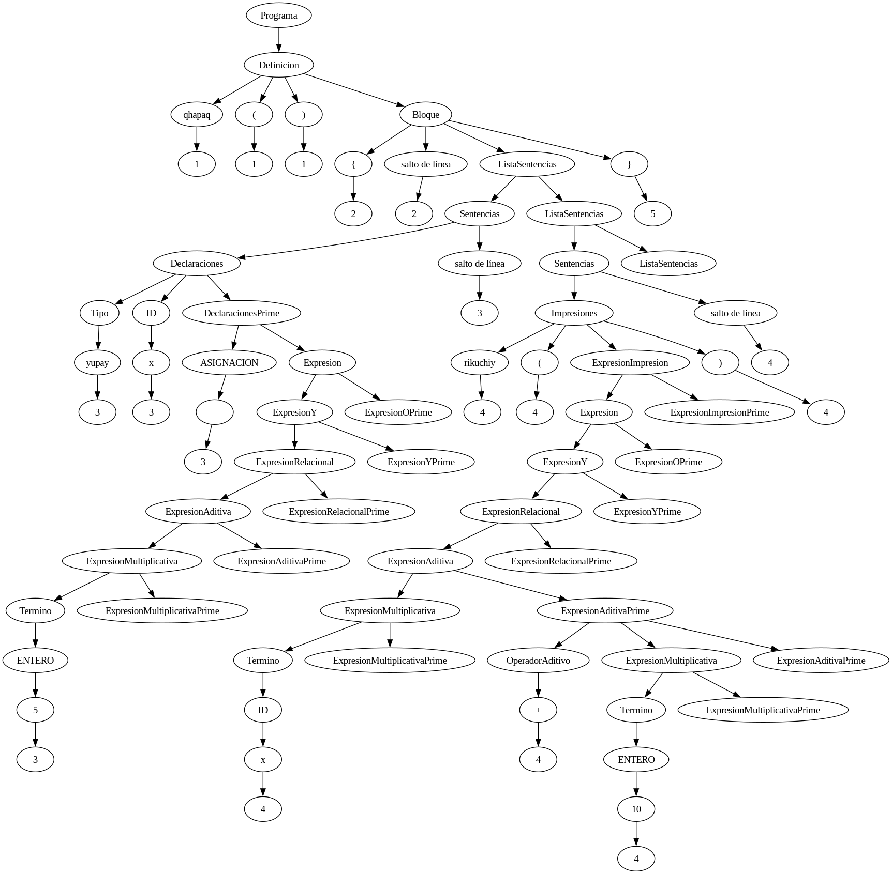

# Antachawi Compiler

This project aims to develop a compiler for a new programming language called Antachawi, which uses Quechua as the basis for its syntax and terms. This effort seeks to reduce the digital divide currently present in Peru by promoting the use of accessible programming languages and technologies for Quechua-speaking communities. This language is based on Quechua Collao.

## Prerequisites

- Python 3.8 or higher
- pip (Python package manager)
- git
- An x86-64 assembler and linker. The compiler generates x86-64 assembly
  and uses them to build the executable:
  - Linux (x86-64): `gcc` (or `cc` / `clang`).
  - macOS: the Xcode command line tools (`xcode-select --install`). On Macs
    with an Apple processor the program is built for x86-64 and runs with
    Rosetta 2.
  - Windows (x86-64): `gcc` from MinGW-w64 (for example, from MSYS2) in the
    `PATH`.

## Creating and Activating a Virtual Environment

First, clone the repository.

```bash
git clone https://github.com/GiomarMC/Antachawi.git
```

Then navigate to the project folder and proceed with creating the virtual environment.

### On Windows

1. Open a terminal (cmd, PowerShell, or Git Bash).
2. Navigate to the project directory.
3. Create a virtual environment with the following command:

    ```bash
    python -m venv .venv
    ```

4. Activate the virtual environment:

    ```bash
    .\.venv\Scripts\activate
    ```

### On Linux/MacOS

1. Open a terminal.
2. Navigate to the project directory.
3. Create a virtual environment with the following command:

    ```bash
    python3 -m venv .venv
    ```

4. Activate the virtual environment:

    ```bash
    . .venv/bin/activate
    ```

## Installing the Compiler and Its Requirements

Once the virtual environment is activated, install the package using one of the following commands:

### On Windows
```bash
# Install build tools
pip install build hatchling

# Build the package
python -m build

# Install the package using the generated files
pip install dist\antachawi-0.0.1-py3-none-any.whl
# Or alternatively:
# pip install dist\antachawi-0.0.1.tar.gz
```

### On Linux/MacOS
```bash
# Install build tools
pip install build hatchling

# Build the package
python3 -m build

# Install the package using the generated files
pip install dist/antachawi-0.0.1-py3-none-any.whl
# Or alternatively:
# pip install dist/antachawi-0.0.1.tar.gz
```

### Development mode (recommended for contributors)

```bash
# Install in editable mode
# If you have defined development dependencies (e.g., pytest, flake8) in pyproject.toml:
pip install -e .[dev]

# Otherwise, just run:
pip install -e .

# Editable mode allows you to modify the source code and test changes
# instantly without rebuilding the package.
```

This will install all the necessary dependencies for the project.

## Running the Compiler

With the virtual environment activated and the Python package installed, you can run the compiler using the following command:

```bash
antachawi archivo.awi
```

Replace archivo.awy with the name of the source file you want to compile.
By default, the compiler will generate an executable file called `run`
(`run.exe` on Windows). To run the executable:

```bash
./run          # Linux and macOS
.\run.exe      # Windows
```

## Additional Options

The Antachawi compiler includes a CLI, and the available commands can be accessed using the following command:

```bash
antachawi -h
```

The following options will appear:

```bash
-o, --output: Specifies the name of the output file (generated executable).
-d, --debug: Generates debugging files in the `outputs` folder.  
-n, --no-optimizar, --mana-allinchaspa: Skips the optimization phase.
-i, --idioma, --simi {es,qu,ambos}: Language of the error messages
                     (default: ambos = Spanish with Quechua below).
--json: Only analyzes the program and prints every phase as JSON
        (errors, tokens, symbols, intermediate code). Used by editors/IDEs.
--traza: With --json, also runs the program with the interpreter and
         includes the step-by-step trace.
-v, --version: Displays the compiler version.
```

The command exits with code 1 when compilation fails.

## Antachawi Yachay (graphical environment)

A desktop environment for learning to program in Antachawi, aimed at
children (about 10–12 years old). Tunki, a pixel-art Andean
cock-of-the-rock (*tunki* in Quechua), flies to the line with an error and
explains it in Spanish and Quechua.

```bash
pip install -e ".[ide]"        # installs PySide6
antachawi-ide                  # or: python -m antachawi.ide [file.awi]
```

* The program is checked while you type; errors are underlined and listed.
* Click Tunki to go to the next error.
* **Ejecutar** (F5) runs the program with the built-in interpreter, so gcc
  is not needed. Runtime errors (division by zero, endless loops) are
  reported on the line where they happen.
* **Ejemplos** has short programs for beginners, including one with
  errors on purpose.

The drawing of Tunki is a text grid in `antachawi/ide/sprite.py`; it can be
edited letter by letter.

## Using the compiler from Python

`antachawi/api.py` runs every phase without printing or writing files:

```python
from antachawi.api import analizar

resultado = analizar('qhapaq()\n{\n    rikuchiy(1)\n}\n')
resultado.exito            # True
resultado.errores          # [] (each error has codigo, textos, linea...)
resultado.intermedio       # three-address code (each instruction has .pos)
resultado.ejecutar()       # step-by-step trace from the interpreter
```

## How the compiler works

The compiler follows the phases described in *Compilers: Principles,
Techniques, and Tools* (the Dragon Book). It does not translate to another
high-level language: it generates x86-64 machine code (as assembly).

| Phase | File | Dragon Book |
|-------|------|-------------|
| Lexical analysis | `scanner.py` | Ch. 3 |
| Syntax analysis (LL(1), recursive descent) | `parser.py`, `grammar.py` | Ch. 4 |
| Abstract syntax tree | `constructor_ast.py`, `ast_nodos.py` | 5.3 |
| Semantic analysis (scopes, types) | `semantic.py`, `tipos.py`, `symboltable.py` | 2.7, 6.5 |
| Three-address code | `intermedio.py` | 6.2, 6.4, 6.6 |
| Basic blocks and flow graph | `bloques_basicos.py` | 8.4 |
| Optimization | `optimizador.py` | 8.5, 8.7, 9.1, 9.2 |
| Code generation (x86-64) | `generador_x86.py` | Ch. 7, 8.6, 8.8 |
| Platforms (Linux, macOS, Windows) | `plataformas.py` | — |

**Three-address code.** Each expression is split into instructions with at
most one operator, using temporaries (`t1 = a * b`). Integers are converted
to decimals explicitly (`t2 = (chunkayuq) a`). Conditions are translated
into jumps with short-circuit evaluation: in `a > 0 && b > 0`, `b > 0` is
not evaluated when `a > 0` is false. Loops become a condition at the top
and a jump back at the end.

**Optimization.** The passes repeat until the code does not change:

- local optimization of each basic block: constant and copy propagation,
  constant folding, algebraic identities (`x + 0`, `x * 1`...), common
  subexpressions and jumps whose condition is known;
- removal of unreachable blocks;
- dead code elimination with live-variable analysis;
- peephole optimization: jumps to jumps, jumps to the next instruction,
  unused labels.

Since Antachawi programs do not read input, most programs are reduced to
printing constants. Use `-n` to compare with the code without optimization.

**Code generation.** The whole program is the `main` function.
`rikuchiy` calls `printf` from the C library. Registers are assigned in two
steps:

- *Global allocation (8.8.2):* the integer variables that pass from one
  basic block to another and are used the most (a use inside a loop counts
  10 times) get a fixed register for the whole program (`rbx`, `r12`,
  `r13`).
- *Local allocation (8.6):* inside each basic block, the generator keeps a
  register descriptor (which variables are in each register) and an
  address descriptor (where the current value of each variable is). For
  `x = y op z`, `getReg` reuses the register of `y` when `y` is no longer
  needed, or takes a free one, or the one that is cheapest to free. A copy
  `x = y` generates no code. At the end of a block, and before calling a C
  function, the values that are still live are stored in memory.

Only the variables that must be stored get an 8-byte slot in the
activation record (`[rbp - 8]`, `[rbp - 16]`...).

| Type        | Representation |
|-------------|----------------|
| `yupay`     | 64-bit signed integer |
| `chunkayuq` | 64-bit floating point (`double`), printed like `%g` |
| `sananpa`   | Unicode code point, printed in UTF-8 |
| `bool`      | 0 or 1 |
| `qaytu`     | address of a zero-terminated string |

For example, for this program:

```bash
qhapaq ()
{
    yupay x = 5
    rikuchiy (x + 10)
}
```

the three-address code (`outputs/intermediate/codigo_intermedio.txt`) is

```bash
    x = 5
    t1 = x + 10
    param t1
    call rikuchiy, 1
```

the optimized code (`outputs/intermediate/codigo_optimizado.txt`) is

```bash
    param 15
    call rikuchiy, 1
```

and the generated assembly (`outputs/codegen/programa.s`) is

```bash
main:
    push rbp
    mov rbp, rsp
    # | param 15
    # | call rikuchiy, 1
    mov rsi, 15
    xor eax, eax
    lea rdi, [rip + .Lformato_yupay]
    call printf@PLT
    mov rdi, 10
    call putchar@PLT
    # fin de qhapaq: return 0
    xor eax, eax
    leave
    ret
```

With a loop, the variables that are used the most get a fixed register:

```bash
qhapaq ()
{
    yupay suma = 0
    imapaq (yupay i = 1; i <= 10; i = i + 1) {
        suma = suma + i
    }
    rikuchiy (suma)
}
```

```bash
# Variables con registro fijo:
#   rbx  i : yupay
#   r12  suma : yupay
    ...
    mov r12, 0
    mov rbx, 1
.LL1:
    # | if i > 10 goto L2
    cmp rbx, 10
    jg .LL2
    # | suma = suma + i
    add r12, rbx
    # | i = i + 1
    add rbx, 1
    # | goto L1
    jmp .LL1
.LL2:
```

## About the Language

### Program structure

Every program lives inside `qhapaq () { ... }`. There is **one statement per
line**: the end of the line ends the statement. Blank lines and comments can be
placed anywhere.

- Line comment: `:: comment`
- Block comment: `:* comment *:`

### Basic Operations

The Antachawi language supports the following basic operations, with the usual
precedence (`*` and `/` before `+` and `-`, left to right) and parentheses:

- Addition: + (example: c = a + b).
- Subtraction: - (example: c = a - b).
- Multiplication: * (example: c = a * b).
- Division: / (example: c = a / b).
- Negation: - (example: c = -(a + b) * 2).

Comparisons and logical operators can be used in any expression, for example
`bool mayor = edad >= 18 && edad < 60` or `rikuchiy (a > b)`. From lowest to
highest precedence:

| Precedence | Operators              |
|------------|------------------------|
| lowest     | `\|\|`                 |
|            | `&&`                   |
|            | `< > <= >= == !=`      |
|            | `+ -`                  |
|            | `* /`                  |
| highest    | `-` (negation)         |

Comparisons cannot be chained: write `a < b && b < c` instead of `a < b < c`.

### Literals

- Numbers: `42`, `3.14`, `.5`
- Characters: `'a'`; text: `"hola"`. Both accept the escape sequences
  `\n` (new line), `\t` (tab), `\r`, `\0`, `\\`, `\'` and `\"`, for example
  `rikuchiy ("dijo \"hola\"\n")`. Any Unicode character can be used:
  `'ñ'`, `'€'`, `"ñandú"`.
- Booleans: `chiqaq` (true) and `yanqa` (false).

### Conditionals

`ari` (if), `mana_chayqa_ari` (else if) and `mana_chayqa` (else) can be nested
without limit. Conditions support arithmetic expressions, the relational
operators `> < >= <= == !=` and the logical operators `&&` and `||` (`&&` binds
tighter than `||`). A `bool` variable can be used directly as a condition.

The opening brace may go on the same line or on the next one, and
`mana_chayqa` may follow the closing brace on the same line or on the next one:

```bash
ari (a + 1 > 10 && b != 0)
{
    rikuchiy ("a")
}
mana_chayqa_ari (bandera) {
    ari (a < 0) {
        rikuchiy ("b")
    }
} mana_chayqa {
    rikuchiy ("c")
}
```

The body of a block always starts on a new line after `{` and the closing `}`
goes on its own line.

### Loops

`chaykama` (while) repeats a block while its condition is true:

```bash
yupay n = 3
chaykama (n > 0) {
    rikuchiy (n)
    n = n - 1
}
```

`imapaq` (for) has three parts separated by `;`: a declaration or an
assignment that runs once, the condition, and an assignment that runs after
each repetition. A variable declared in `imapaq` only exists inside the
loop:

```bash
imapaq (yupay i = 0; i < 5; i = i + 1) {
    rikuchiy ("i es ", i)
}
```

The condition of both loops must be a `bool`.

### Reserved Words

Below is a list of the reserved words in the Antachawi language and their functionality.

| Reserved word     | Functionality                          |
|-------------------|----------------------------------------|
| `qhapaq`          | Defines the start of a program         |
| `rikuchiy`        | Print function                         |
| `ari`             | If                                     |
| `mana_chayqa_ari` | Else if                                |
| `mana_chayqa`     | Else                                   |
| `chaykama`        | While loop                             |
| `imapaq`          | For loop                               |
| `bool`            | Boolean data type                      |
| `yanqa`           | Boolean false                          |
| `chiqaq`          | Boolean true                           |
| `yupay`           | Integer data type                      |
| `chunkayuq`       | Float data type                        |
| `sananpa`         | Character data type                    |
| `qaytu`           | String data type                       |

### Types and rules

| Type        | Values                | Example            |
|-------------|-----------------------|--------------------|
| `yupay`     | integers              | `yupay a = 5`      |
| `chunkayuq` | decimals              | `chunkayuq b = 2.5`|
| `sananpa`   | one character         | `sananpa c = 'x'`  |
| `qaytu`     | text                  | `qaytu s = "hola"` |
| `bool`      | `chiqaq` / `yanqa`    | `bool v = chiqaq`  |

The compiler checks the types of every expression:

- `+ - * /` work with numbers. Mixing `yupay` and `chunkayuq` is allowed and
  the result is `chunkayuq`. `+` also joins two `qaytu` values.
- `< > <= >=` compare numbers or two `sananpa`; `== !=` compare values of the
  same type (or two numbers). Both give a `bool`, which can be stored in a
  `bool` variable.
- `&&` and `||` only work with `bool`.
- The condition of `ari` / `mana_chayqa_ari` must be a `bool`.
- A `yupay` can be stored in a `chunkayuq` variable, but not the other way
  around (the decimals would be lost).

Each block `{ }` has its own scope: a variable declared inside an `ari` does
not exist outside of it. A variable cannot be declared again in the same
block, nor reuse the name of a variable from an outer block.

The compiler also shows **warnings**, which do not stop the compilation:
variables that are never used, variables that could be used before they get a
value (for example, assigned only inside an `ari` without `mana_chayqa`) and
divisions by zero.

### Grammar

The LL(1) grammar of the language lives in
[`antachawi/grammar.py`](antachawi/grammar.py). The FIRST and FOLLOW sets used by
the parser are computed from it, and the test suite checks that it has no
LL(1) conflicts.

### Example

Below is an example of source code using the Antachawi language.

```bash
qhapaq ()
{
    yupay a = 1
    yupay b = 2
    yupay c
    c = a * b
    sananpa letra = 'A'
    rikuchiy ("La multiplicacion de ", a, " * ", b, " es ", c)
    rikuchiy ("La letra es ", letra)
}
```

Assuming the file is named main.awi, an example compilation would be as follows:

```bash
antachawi main.awi -o main
```

An executable file will be generated, which you can run following the previous steps.

If debugging is enabled, the tokens, the parse tree, the abstract syntax tree
with the type of every expression (`outputs/semantic/ast.txt`), the symbol
table, the three-address code and its basic blocks before and after
optimization (`outputs/intermediate/`) and the generated assembly
(`outputs/codegen/programa.s`) will be stored in a folder named `outputs`.
For example, for this program:

```bash
qhapaq ()
{
    yupay x = 5
    rikuchiy (x + 10)
}
```

the parse tree (`outputs/sintactic/AbstractSyntaxTree.txt`) is the following.
Each token stores the line where it was found. The abstract syntax tree used
by the semantic analysis (`outputs/semantic/ast.txt`) is much smaller:

```bash
Programa
└── Bloque
    ├── Declaracion yupay x
    │   └── Literal 5 : yupay
    └── Imprimir
        └── Binaria + : yupay
            ├── Variable x : yupay
            └── Literal 10 : yupay
```

The parse tree is:

```bash
Programa
└── Definicion
    ├── qhapaq
    │   └── 1
    ├── (
    │   └── 1
    ├── )
    │   └── 1
    └── Bloque
        ├── {
        │   └── 2
        ├── salto de línea
        │   └── 2
        ├── ListaSentencias
        │   ├── Sentencias
        │   │   ├── Declaraciones
        │   │   │   ├── Tipo
        │   │   │   │   └── yupay
        │   │   │   │       └── 3
        │   │   │   ├── ID
        │   │   │   │   └── x
        │   │   │   │       └── 3
        │   │   │   └── DeclaracionesPrime
        │   │   │       ├── ASIGNACION
        │   │   │       │   └── =
        │   │   │       │       └── 3
        │   │   │       └── Expresion
        │   │   │           ├── ExpresionY
        │   │   │           │   ├── ExpresionRelacional
        │   │   │           │   │   ├── ExpresionAditiva
        │   │   │           │   │   │   ├── ExpresionMultiplicativa
        │   │   │           │   │   │   │   ├── Termino
        │   │   │           │   │   │   │   │   └── ENTERO
        │   │   │           │   │   │   │   │       └── 5
        │   │   │           │   │   │   │   │           └── 3
        │   │   │           │   │   │   │   └── ExpresionMultiplicativaPrime
        │   │   │           │   │   │   └── ExpresionAditivaPrime
        │   │   │           │   │   └── ExpresionRelacionalPrime
        │   │   │           │   └── ExpresionYPrime
        │   │   │           └── ExpresionOPrime
        │   │   └── salto de línea
        │   │       └── 3
        │   └── ListaSentencias
        │       ├── Sentencias
        │       │   ├── Impresiones
        │       │   │   ├── rikuchiy
        │       │   │   │   └── 4
        │       │   │   ├── (
        │       │   │   │   └── 4
        │       │   │   ├── ExpresionImpresion
        │       │   │   │   ├── Expresion
        │       │   │   │   │   ├── ExpresionY
        │       │   │   │   │   │   ├── ExpresionRelacional
        │       │   │   │   │   │   │   ├── ExpresionAditiva
        │       │   │   │   │   │   │   │   ├── ExpresionMultiplicativa
        │       │   │   │   │   │   │   │   │   ├── Termino
        │       │   │   │   │   │   │   │   │   │   └── ID
        │       │   │   │   │   │   │   │   │   │       └── x
        │       │   │   │   │   │   │   │   │   │           └── 4
        │       │   │   │   │   │   │   │   │   └── ExpresionMultiplicativaPrime
        │       │   │   │   │   │   │   │   └── ExpresionAditivaPrime
        │       │   │   │   │   │   │   │       ├── OperadorAditivo
        │       │   │   │   │   │   │   │       │   └── +
        │       │   │   │   │   │   │   │       │       └── 4
        │       │   │   │   │   │   │   │       ├── ExpresionMultiplicativa
        │       │   │   │   │   │   │   │       │   ├── Termino
        │       │   │   │   │   │   │   │       │   │   └── ENTERO
        │       │   │   │   │   │   │   │       │   │       └── 10
        │       │   │   │   │   │   │   │       │   │           └── 4
        │       │   │   │   │   │   │   │       │   └── ExpresionMultiplicativaPrime
        │       │   │   │   │   │   │   │       └── ExpresionAditivaPrime
        │       │   │   │   │   │   │   └── ExpresionRelacionalPrime
        │       │   │   │   │   │   └── ExpresionYPrime
        │       │   │   │   │   └── ExpresionOPrime
        │       │   │   │   └── ExpresionImpresionPrime
        │       │   │   └── )
        │       │   │       └── 4
        │       │   └── salto de línea
        │       │       └── 4
        │       └── ListaSentencias
        └── }
            └── 5
```

You can also view the tree as an image:



### Error messages

Every error has a fixed code (`LEX`, `SIN`, `SEM`, `ADV`, `EJE`), and shows
the line and column where it was found, the source line and the exact place
underlined. By default the message is shown in Spanish with the Quechua
translation below (`--idioma` changes this):

```bash
Error SIN001 en 5:16: se encontró 'salto de línea', pero se esperaba ')'.
    qu: 'salto de línea' tariqchasqa, ichaqa ')' suyaywasqa.
    5 |     rikuchiy (a
      |                ^
```

All messages live in `antachawi/mensajes.py`. Messages without a Quechua
translation yet have `qu=None` and are shown in Spanish;
`mensajes.pendientes_de_traduccion()` lists them.

Translations can also be added **without touching the code**: fill the
`quechua` column of `antachawi/traducciones/quechua.csv` (opens with
LibreOffice Calc or Excel); it is loaded on import and takes priority over
`mensajes.py`. Example programs for the IDE are translated by copying them
into `antachawi/ide/ejemplos/qu/` with the same number. Instructions for
translators (in Spanish) are in `antachawi/traducciones/LEEME.md`.

```bash
python -m antachawi.traduccion revisar      # what is missing, problems
python -m antachawi.traduccion actualizar   # add new messages to the sheet
```

When something is *missing* at the end of a line (for example a `)`), the
error points right after the last valid token of that line, even if the next
token is on the following line.

## Running the tests

```bash
pip install -e .[dev]
pytest
```

The end-to-end tests (`tests/test_compilador.py`) compile and run every
program twice, with and without optimization, and check the output. The
differential tests (`tests/test_diferencial.py`) generate random programs,
compile and run them, and compare their output with an interpreter of the
three-address code (`tests/interprete.py`). Both need an x86-64 machine
with `gcc`, `cc` or `clang`, and are skipped otherwise. If `clang` is
installed, the assembly for macOS and Windows is also checked from any
platform.

## Code style

The code follows PEP 8 with a maximum of **79 characters per line** and a
maximum cognitive complexity of 15 per function (the same limit SonarQube
uses). Both rules are configured in `.flake8` and checked by the test suite
(`tests/test_estilo.py`). Imports are ordered with isort:

```bash
flake8 antachawi tests
isort antachawi tests
```

## Contributions

Contributions are welcome! Feel free to open issues or pull requests to improve the project.